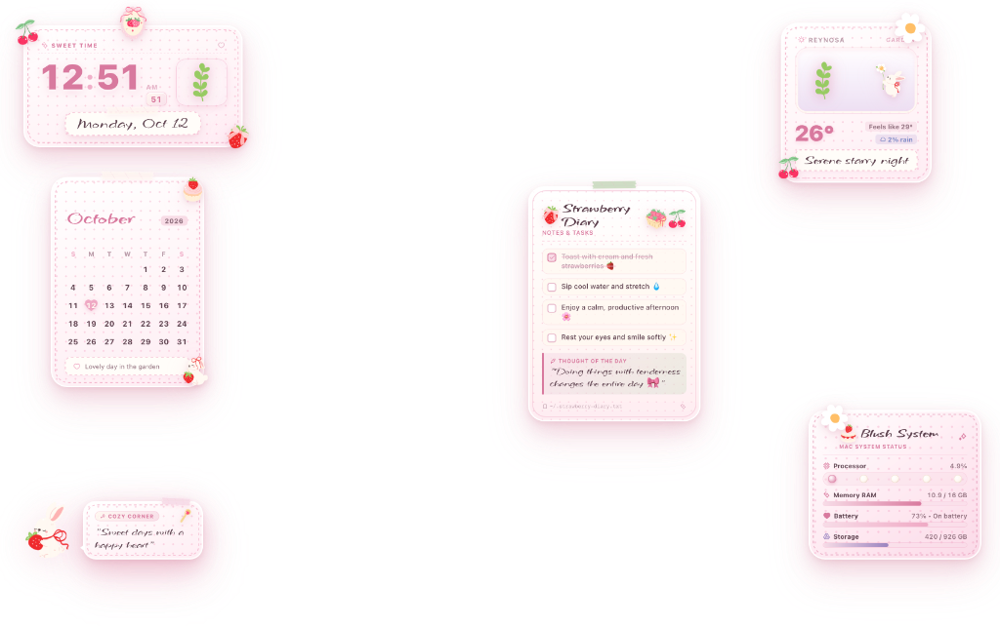

# Sxnny Pink Daydream




<p align="center">
  <strong>Pastel Stationery Suite ✦ Tactile Scrapbook Desktop ✦ Ergonomic macOS Sanctuary</strong><br>
  <em>An artisanal desktop suite turning macOS into an intimate, warm, and poetic stationery desk.</em>
</p>

<p align="center">
  <a href="#about">About</a> ✦
  <a href="#features">Features</a> ✦
  <a href="#installation">Installation</a> ✦
  <a href="#usage">Usage</a> ✦
  <a href="#architecture">Architecture</a>
</p>

---

## About

**Sxnny Pink Daydream** is a curated desktop stationery suite for macOS running on [Übersicht](https://tracesof.net/uebersicht/).

Modern desktop operating systems are often cold, utilitarian, and visually sterile. Sxnny Pink Daydream exists to bring warmth, tenderness, and tactile joy back to your personal workspace. Inspired by Japanese craft stationery, coquette scrapbooks, and gentle botanical notebooks, the suite transforms the desktop into an inviting creative studio layered with textured polka-dot cards, washi tape, delicate ribbons, and comforting illustrations.

Every piece is engineered to live harmoniously alongside your daily work: each card floats seamlessly with dedicated ergonomic drag handles, zero desktop click blockage, and quiet, responsive system telemetry disguised as fine jewelry.

### Philosophy

> *"Technology should feel as warm and intimate as handwritten letters on cream stationery, inviting calm, delight, and gentle focus into your workspace."*

Personal project by HoujouSxnnyside. Part of the [Sxnnyside Project](https://sxnnysideproject.com).

## Features

- **Sweet Time (Confectionery Clock)**: A warm bakery-style digital clock featuring soft typography, handwritten date cards, and pastel ribbons.
- **Weather Garden (Living Botanical Forecast)**: An illustrated terrarium reflecting real-time weather conditions, atmospheric humidity, and gentle seasonal phrases.
- **Little Calendar (Stationery Planner)**: A monthly desktop calendar with heart-stamped days, weekend blush accents, and integration with your upcoming events.
- **Teddy Corner (Gentle Daily Companion)**: A comforting desktop companion offering thoughtful, handwritten reflections and affirmations to ground your working hours.
- **Strawberry Diary (Tear-off Memo & Checklist)**: A personal stationery notepad with custom checkbox tasks, inspirational daily memos, and quick plain-text syncing.
- **Blush System (Coquette Jewel Monitor)**: Whisper-quiet system telemetry disguised as handcrafted jewelry — pearl beads for processor load, rose petal gauges for memory, and glowing heart gems for battery level.
- **Ergonomic Desktop Freedom**: Transparent hitboxes ensure zero desktop blockage; drag each stationery card using dedicated vintage washi handles with persistent coordinates across reboots.

## Installation

### Prerequisites

- macOS 14.0+ (Sonoma or Sequoia)
- [Übersicht](https://tracesof.net/uebersicht/) (Installed and running)

### Quick Install (Non-Technical)

No terminal, compiler, or developer tooling required:

1. **Download**: Get the latest release archive [`sxnny-pink-daydream.zip`](https://github.com/HoujouSxnnyside/uebersicht-sxnny-widgets-flavor-pink-daydream/releases/latest/download/sxnny-pink-daydream.zip).
2. **Extract**: Double-click the `.zip` archive to extract the `sxnny-pink-daydream/` folder.
3. **Open Widgets Folder**: Click the **Übersicht** icon in your macOS menu bar and choose **Open Widgets Folder** (or navigate to `~/Library/Application Support/Übersicht/widgets/`).
4. **Place**: Drop the extracted `sxnny-pink-daydream/` folder into your Widgets directory.
5. **Enjoy**: Click **Refresh All Widgets** in the Übersicht menu bar. Your desktop stationery cards will appear immediately.

### From Source

For local development or customization (requires [Bun](https://bun.sh) `>= 1.1.0`, [Swift](https://swift.org) `>= 6.0`, and [Just](https://github.com/casey/just)):

```bash
git clone https://github.com/HoujouSxnnyside/uebersicht-sxnny-widgets-flavor-pink-daydream.git
cd uebersicht-sxnny-widgets-flavor-pink-daydream

just install
just build
just link
```

## Usage

```bash
# Start live development watcher
just dev

# Run unified quality gate and linters
just check

# Package distribution archive for Übersicht
just package
```

### Desktop Interactions

- **Repositioning Widgets**: Click and drag any card by its dedicated top handle (`[data-drag-handle="true"]`) to place it anywhere on screen. Positions persist in `localStorage`.
- **Reset Position**: Double-click any card handle to return it to its default layout position.
- **Desktop Access**: All empty and transparent areas pass clicks directly through to macOS desktop icons and files.
- **Editing Notes**: To customize your personal tasks and thoughts, edit `~/.strawberry-diary.txt` with plain-text checkboxes (`[ ]`, `[x]`) and quotes (`>`).

## Architecture

```
uebersicht-sxnny-widgets-flavor-pink-daydream/
├── src/
│   ├── widgets/              # Six stationery desktop widgets (React + Emotion)
│   │   ├── sweet-time/       # Confectionery digital clock and date
│   │   ├── weather-garden/   # Illustrated living botanical weather card
│   │   ├── little-calendar/  # Monthly calendar with EventKit events
│   │   ├── teddy-corner/     # Companion teddy and daily reflections
│   │   ├── strawberry-diary/ # Tear-off notes and checklist notepad
│   │   └── blush-system/     # Coquette jewel system telemetry monitor
│   └── shared/               # Shared typography, tokens, and stationery assets
├── native/                   # Native Swift CLI utilities (weather, calendar, system)
├── scripts/                  # Build, packaging, and Übersicht linking tools
├── docs/assets/              # Suite visual previews and screenshots
└── dist/                     # Distribution bundles (sxnny-pink-daydream/)
```

## License

This project is licensed under the SPUL — see the [LICENSE](LICENSE) file for details.

## Notes

All visual illustration assets and decorative artwork were created by [starcolors13](https://www.deviantart.com/starcolors13).

---

<p align="center">
  <strong>Sxnny Pink Daydream</strong> — Personal project by HoujouSxnnyside<br>
  <em>&copy; 2026 Sxnnyside Project</em>
</p>
